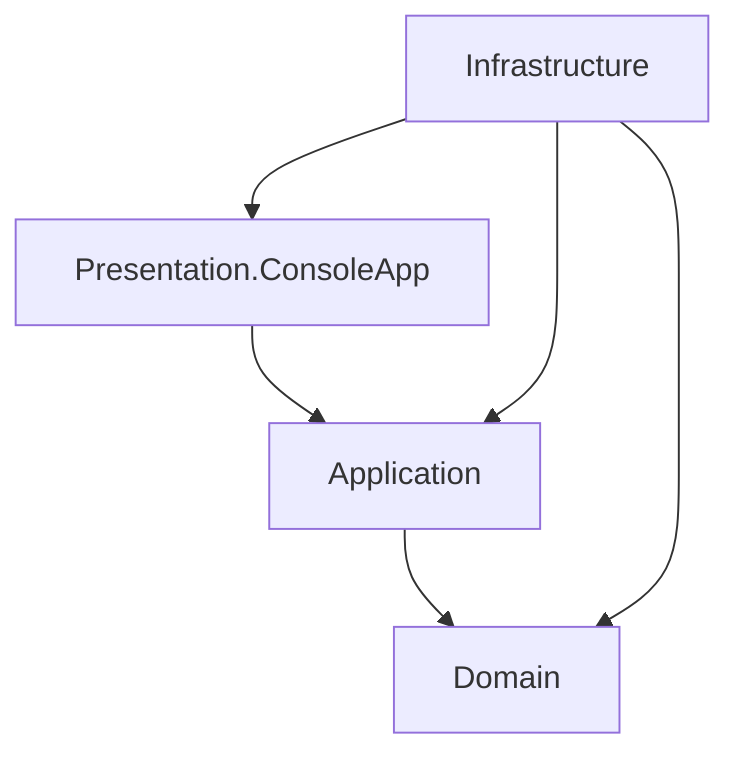

<div align="center">

# 📚 Library Management System

**A feature-rich library management system written in C#, evolving from a console application toward a full-stack web application.**


</div>

---

The Library Management System (LMS) simulates real library operations: catalog management, memberships, borrowing and returns, fines, authentication, role-based permissions and audit history.

The system is organized into four projects: Domain, Application, Infrastructure and Presentation. This separation keeps core entities, application workflows and console interactions organized, while version 2.0.0 progressively introduces database persistence.
<!-- Add a screenshot of the main menu here, for example:

-->

## ✨ Features

| Area | What it does |
|------|--------------|
| 📖 **Catalog** | Books with one or more authors and optional translators, genres, validated ISBNs, soft deletion |
| 👥 **Users** | Member, Librarian and Admin roles (one role per user), membership dates and renewal, self-service profile editing |
| 🔄 **Loans** | Borrow, return and renew; views for active, overdue, inactive and full loan history, for yourself, by user, by book or library-wide |
| 💰 **Fines** | Tiered, geometric fine calculation with a cap; pay or waive; borrowing is blocked above the fine limit |
| 🔐 **Security** | Email and password login, salted HMAC-SHA512 hashing, constant-time comparison, session handling |
| 🛡️ **Authorization** | Permission-based access, enforced in the menus **and** in the application services |
| 🧾 **Audit** | Append-only audit log plus loan and fine history; sensitive values are not written into audit text |
| 🖥️ **Console UX** | Permission-gated menus, Unicode tables, search and sort, `cancel` at any prompt, member-safe views |
| 📊 **Statistics** | Library-wide counts for books, copies, members, loans, overdue loans and unpaid fines |

## 🖥️ Console preview

```text
╔═══════════════════ Edit User ═══════════════════╗
║ # │ Field         │ Current Value               ║
╟───┼───────────────┼─────────────────────────────╢
║ 1 │ First Name    │ Mohammad                    ║
║ 2 │ Last Name     │ Ahmadi                      ║
║ 3 │ Email         │ m.ahmadi@example.com        ║
║ 4 │ Back          │ -                           ║
╚═══╧═══════════════╧═════════════════════════════╝
```

*Illustrative output of the built-in table renderer.*

## 🚀 Getting started

**Requirements**

- [.NET 10 SDK](https://dotnet.microsoft.com/download)
- Visual Studio 2022/2026, Rider or VS Code
- A UTF-8 capable terminal (Windows Terminal recommended) so the box-drawing tables render correctly

**Run it**

```bash
git clone https://github.com/<your-username>/LibraryManagementSystem.git
cd LibraryManagementSystem
dotnet build
dotnet run --project LibraryManagementSystem.Presentation.ConsoleApp
```

> Data lives in memory in this version, so everything resets when the program exits. Sample data is created at startup.

**Demo accounts** (sample data only)

| Role | Email | Password |
|------|-------|----------|
| Admin | `admin@library.com` | `Admin@123` |
| Librarian | `librarian@library.com` | `Librarian1@123` |
| Member | `m.ahmadi@example.com` | `Member1@123` |

## 🔑 Roles at a glance

| Role | Typical abilities |
|------|-------------------|
| **Member** | Search the catalog, borrow and return books, view their own loans and history, edit their own profile |
| **Librarian** | Everything a member can do, plus managing the catalog and members, and viewing loans by user or by book |
| **Admin** | Full access, including changing user roles and viewing removed records |

Menus show only what the current user is allowed to do. When a menu would have a single option, it is skipped and the user lands directly on that screen.

## 🏗️ Architecture

The solution is organized into four projects, each with a distinct responsibility. The current implementation uses a layered architecture, with project references defining how the layers communicate.

### Project dependencies



The arrows represent project references: the project at the beginning of an arrow references the project at its end.

**Current dependency relationships:**

- **Application → Domain:** Application services use domain entities, contracts and rules.
- **Presentation → Application:** The console application invokes application services.
- **Infrastructure → Domain, Application and Presentation:** Infrastructure currently integrates with all three projects.

> This diagram documents the current project references; it is not a claim that the solution follows strict Clean Architecture dependency rules.


### Layer responsibilities

| Project | Responsibility |
|---|---|
| **Domain** | Core entities, domain interfaces, configuration, exceptions and rules. |
| **Application** | Application services, authentication, authorization, in-memory repositories, security-related application components, seeders, mapping, menus and validation. |
| **Infrastructure** | DTOs, enums, value objects, interfaces and shared infrastructure components. |
| **Presentation.ConsoleApp** | Console menus, printers, input helpers and the application entry point. |

### Solution structure

```text
LibraryManagementSystem/
│
├── LibraryManagementSystem.Application/
│   ├── Authentication/
│   ├── Authorization/
│   ├── Common/
│   ├── Mapping/
│   ├── Menu/
│   ├── Repositories/
│   │   └── InMemory/
│   ├── Security/
│   ├── Seeders/
│   ├── Services/
│   └── Validators/
│
├── LibraryManagementSystem.Domain/
│   ├── Configuration/
│   ├── Entities/
│   ├── Exceptions/
│   ├── Interfaces/
│   └── Rules/
│
├── LibraryManagementSystem.Infrastructure/
│   ├── Common/
│   ├── DTOs/
│   ├── Enums/
│   ├── Interfaces/
│   └── ValueObjects/
│
└── LibraryManagementSystem.Presentation.ConsoleApp/
    ├── Helpers/
    ├── Menus/
    ├── Printers/
    └── Program.cs
```

The solution also contains the project files (`.csproj`), the solution file, repository configuration files and the README.

### Version 2.0.0 architecture direction

Version 2.0.0 introduces database persistence using Entity Framework Core. The existing application behavior and service workflows will be retained as much as possible while the persistence implementation is developed incrementally.

The migration will proceed module by module, beginning with authors and translators. The console application will remain usable while the database integration is developed.

## 🧠 Design highlights

- **Dependency inversion:** services depend on repository interfaces, so swapping the storage engine only touches Infrastructure.
- **`ServiceResult<T>`:** every service call returns `Ok`, `Warning` or `Fail` with a message, so the UI never needs exceptions for normal flow.
- **Validate first, then change:** guard clauses run before any state is modified.
- **Value objects:** `Email`, `PhoneNumber`, `ISBN` and `BookGenre` validate themselves on creation, so invalid values cannot be constructed.
- **Defense in depth:** permissions are checked in the menus and again in the services.
- **Soft deletion and audit trail:** records are flagged instead of destroyed, and administrative actions are logged.
- **Timing-safe login:** constant-time hash comparison, and a dummy comparison for unknown emails to prevent user enumeration.

## 🧭 Roadmap

| Version | Focus | Status |
|---------|-------|--------|
| **v1.0.0** | Console app with in-memory repositories | ✅ Released |
| **v1.5.0** | Architecture refinement before the database work | ✅ Released |
| **v2.0.0** | Entity Framework Core and SQL Server persistence | 🚧 In progress |
| **v3.0.0** | ASP.NET Core Web API | 🗓️ Planned |
| **v4.0.0** | Angular front end | 🗓️ Planned |

### What changed in v1.5.0

- Cleaner layering, with dependencies pointing inward
- Value objects for emails, phone numbers, ISBNs and genres
- One role per user (many-to-one) instead of a role join entity
- A shared `Contributor` model for authors and translators, with a shared generic management service
- Simpler entities, with business rules kept in the application services
- A unified loan view (whose loans, then which filter) replacing the separate View Loans and History menus
- Members can edit their own profile
- Updated documentation

### What comes next (v2.0.0)

The database work moves one module at a time while the console app stays runnable:

1. Authors and translators
2. Users and roles
3. Books and their join tables
4. Loans
5. Fines
6. Loan and fine history
7. Audit log

Each step adds a `DbContext` mapping and an EF Core repository behind the existing interfaces, then removes the in-memory version for that module.

## 🌿 Branches and tags

| Ref | Purpose |
|-----|---------|
| `master` | Stable, released code |
| `V2.0.0` | Active development of the database version |
| `V1.5.0` | Architecture refinement release |
| `V1.0.0` | First complete in-memory release |

## 📄 License

See [LICENSE.txt](LICENSE.txt).
